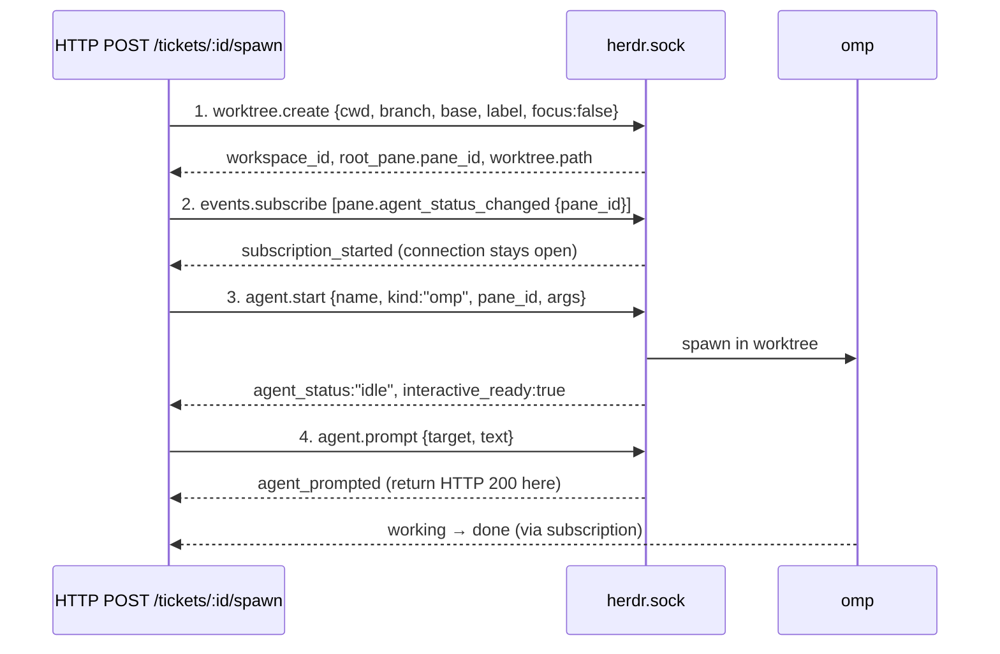

# Herdr worktree + OMP agent lifecycle

**Node 01** · Parent: [INDEX.md](./INDEX.md)

How `10x` goes from an HTTP request to a running OMP agent in its own git worktree and branch,
and back to zero residue.

> **Status: verified.** Every claim below marked *verified* was observed against a live Herdr
> server (herdr `0.8.2`, protocol `20`, socket API schema version `1`) using a throwaway target
> repo. Claims marked *inferred* were reasoned but never executed. Measured timings are real.
> Validated 2026-08-29.

---

## 1. The spawn sequence — 4 socket calls

### Diagram



### Same thing as a table

| # | Call | Send | Get back |
|---|---|---|---|
| 1 | `worktree.create` | `cwd`, `branch`, `base`, `label`, `focus: false` | `workspace_id`, `root_pane.pane_id`, `worktree.path` |
| 2 | `events.subscribe` | `[{type: "pane.agent_status_changed", pane_id}]` | `subscription_started` — **connection stays open** |
| 3 | `agent.start` | `name`, `kind: "omp"`, `pane_id`, `args` | `agent_status: "idle"`, `interactive_ready: true` |
| 4 | `agent.prompt` | `target`, `text` | `agent_prompted` → **return HTTP 200 here** |

Then, asynchronously on the call-2 connection:

```
pane.agent_status_changed  agent_status: "working"        → agent is running
pane.agent_status_changed  agent_status: "done" | "idle"  → turn finished (both, see §4.1)
```

### Ordering rules (all load-bearing)

- **Step 2 must precede step 3.** Subscribe before starting the agent, or you can miss the
  first `working` transition and the ticket appears stuck in In Progress forever.
- **Step 3 must confirm readiness before step 4.** The raw `agent.start` method returns before the
  agent is usable; the CLI polls for you, a socket client must poll itself. See below.
- **Step 4 must not block the HTTP response.** Return 200 as soon as `agent_prompted` comes
  back. Agent runs are open-ended; the subscription reports completion.

#### `agent.start` does not wait — the CLI does. Replicate the CLI.

**This is the single most important implementation detail in this document.** The socket method
`agent.start` returns as soon as it has *dispatched* the agent, not when the agent is usable. The
`herdr agent start` **CLI command** wraps it in a retry-and-poll loop. Anything talking to the
socket directly must do the same.

Identical conditions — `worktree.create` then `agent.start` with zero delay:

| Path | Elapsed | Result |
|---|---|---|
| `herdr agent start` (CLI) | 3285 ms | `status: idle`, `interactive_ready: true` ✓ |
| Raw `agent.start` (one socket call) | 33 ms | `status: unknown`, `interactive_ready` **absent** ✗ |

The request payloads are **byte-identical** — verified by `strace` on the CLI:

```
{"id":"cli:agent:start","method":"agent.start",
 "params":{"name":"ticket-tr-1","kind":"omp","pane_id":"w2F:p1","timeout_ms":60000}}
```

The difference is entirely in what the CLI does *around* that call:

```
ping → pane.get → agent.start        ← 1st attempt, returns premature
     → pane.get → pane.process_info
     → pane.get → pane.process_info
     → agent.start                   ← 2nd attempt
     → agent.get × 24                ← polls until idle + interactive_ready (~125 ms apart)
```

So the 3.2 s is the **CLI polling**, not the server blocking. The 0.8.2 changelog entry (#2410,
#2537, #2773, #2774) describes the CLI command and is accurate; it does not mean the raw method
blocks until ready.

**Raw-socket behaviour, measured over 6 clean trials** (one immediate `agent.start` per fresh
worktree), all returning in 1–2 ms:

| Outcome | Frequency | Shape |
|---|---|---|
| `type: agent_started`, premature | **4 / 6** | `agent_status: "unknown"`, `interactive_ready` absent; next `agent.prompt` → `agent_not_ready` |
| `agent_pane_busy` error | 2 / 6 | honest failure, nothing launched |

Nondeterministic between the two. Only one response frame arrives and the connection then closes —
confirmed by reading the socket to EOF, so this is the final answer, not an interim ack.

It is *premature*, never false — the agent does arrive:

```
agent.start          →   1.4 ms   status=unknown, interactive_ready absent
agent.get (polled)   →   3046 ms  status=idle,    interactive_ready=true
agent.prompt         →            agent_prompted ✓
```

**`interactive_ready` is the tell:** `true` on a real start, **absent** when premature.

**Required guard — mirror the CLI:**

1. Retry `agent_pane_busy` with a short (~100 ms) backoff, bounded by the `agent.start` timeout.
   Exponential backoff starting at 1 s overshoots; the CLI polls at ~125 ms.
2. **Never treat `agent.start`'s return as readiness.** Poll `agent.get` until `agent_status: "idle"`
   **and** `interactive_ready: true`. Expect ~3 s.
3. Treat `agent_not_ready` from `agent.prompt` as "still starting" and retry — not as fatal.

`pane.process_info` is not a readiness signal on its own: it reports `bash` as foreground from 24 ms
onward, and during the busy window shows the shell still sourcing rc files (`dircolors`,
`['bash','bash']`). The CLI queries it as a heuristic but still relies on `agent.get` to decide.

**General lesson:** the CLI is **not** a thin wrapper over the socket API. Where CLI and raw socket
behaviour disagree, assume the CLI adds orchestration and `strace` it — do not assume Herdr is
broken.

#### Confirmed live in the harness

The guard is not theoretical — it fires on ordinary runs. Two real spawns through
`src/runner.ts`, each a single button press:

| Diagnostic | Ticket 1 | Ticket 2 |
|---|---|---|
| `agent_pane_busy` retries | 1 | 2 |
| `agent.start` returned | `unknown`, ready absent, at 313 ms | same |
| Readiness polls needed | 21 | 21 |
| Actually ready after | 3398 ms | 3383 ms |
| Prompt attempts | 1 | 1 |

Without the guard the prompt would have been sent at ~313 ms against an agent reporting
`unknown`, and lost. With it, both tickets committed correctly.

The `interactive_ready` field is also the fix for §4.1's first-`idle` trap in practice: the
harness observed `idle` at t≈1 s (startup), then `working`, then `done` at t≈5 s. Treating that
first `idle` as completion marks a ticket finished before it has done anything — require an
observed `working` first.

### Measured timings (verified)

| Step | Duration |
|---|---|
| `worktree.create` | ~60 ms |
| `agent.start` returns (fresh pane, premature) | 1–2 ms |
| agent actually reaches `idle` + `interactive_ready` | ~3.0 s |
| `agent.prompt` → `done` (trivial one-file ticket) | 15.6 s |
| `worktree.remove` (clean or forced) | ~200–380 ms |

---

## 2. Getting the system prompt and ticket details in

Two different channels. Do not conflate them.

**System prompt → `agent.start` args.** OMP's `--append-system-prompt` accepts a file path.
Keep that file **outside the worktree** (e.g. under a `10x` state dir) so it never pollutes the
ticket's diff or gets committed by the agent.

```
agent.start {
  name: "ticket-<project>-<n>",   // NOT the bare ticket ID — see §6.7
  kind: "omp",
  pane_id: "<from step 1>",
  args: ["--append-system-prompt", "/abs/path/system-prompt.md", "--auto-approve"]
}
```

**Ticket details → `agent.prompt`.** Not as an OMP positional message argument.

Why the split (verified): passing the ticket as an `omp` positional arg makes OMP begin working
during startup, which races Herdr's readiness detection. Keeping startup and the first turn
separate is why `agent.start` reliably returned `interactive_ready: true` in 3.1 s.

Useful OMP flags for unattended runs: `--append-system-prompt`, `--auto-approve`,
`--approval-mode`, `--max-time` (bounds a runaway agent), `--cwd`.

Agent names must match `[a-z][a-z0-9_-]{0,31}` and be unique among live agents. A bare ticket ID
is **not** a valid name when it starts with a digit — always prefix (§6.7).

### Verified end-to-end evidence

A worktree was created on branch `tkt/probe-1`, an OMP agent started in its root pane, and the
prompt *"add an exported `subtract(a, b)` to src/index.ts, then commit"* was sent. Result:
commit `f61fb69` on `tkt/probe-1` containing exactly that function; `main` untouched. Event
stream captured `working` at 01:41:52 → `done` at 01:42:07.

---

## 3. Socket transport contract

**Path:** `~/.config/herdr/herdr.sock` (Linux/macOS default session). Named sessions live under
`sessions/<name>/` in the same config dir.

**The 10x backend does not need to run inside a Herdr pane.** Verified with a fully scrubbed
environment (`env -i`, no `HERDR_*` variables at all): `ping` and `workspace.list` both succeeded.
The socket is plain filesystem IPC — anything that can open the file can drive Herdr. `HERDR_ENV=1`
is a *policy* gate in the agent skill, telling an agent not to meddle with a session it isn't part
of; it is not a technical requirement and not an authentication check.

One consequence: `HERDR_SOCKET_PATH` is only injected into managed panes, so a standalone backend
must derive the default path itself (or take it from config).

**Framing:** newline-delimited JSON over a unix domain socket. It is **not** WebSocket, despite
the request/response + pushed-event model. Do not reach for a WS client.

**Request shape:**

```json
{"id":"<string>","method":"<dotted.method>","params":{}}
```

### Three rules that will bite you (all verified)

1. **The server closes the connection after every response.** Two `ping`s on one socket → the
   second raises `BrokenPipeError`. Use **one connection per request**. Any client built on a
   persistent-connection assumption fails on its second call.
2. **`events.subscribe` is the sole exception** — its connection stays open and streams events.
   First line is the `subscription_started` ack; every later line is a pushed event.
3. **`params` is mandatory, even when empty.** `ping` without `params` returns
   `{"error":{"code":"invalid_request","message":"missing field `params`"}}`.

Raw socket `cwd` and `path` values **must be absolute**. The CLI expands relative paths before
sending; the socket API does not.

**CLI vs. socket:** the `herdr` CLI is **not** a thin wrapper over the socket API — it adds retry
and polling orchestration around some methods, and §1 is the critical case. The application should
speak the socket directly, because event subscriptions have no CLI equivalent, but it must then
replicate that orchestration itself. When CLI and raw-socket behaviour disagree, `strace` the CLI
rather than assuming Herdr is broken. CLI server errors are JSON on stderr with exit 1; CLI syntax
errors exit 2.

---

## 4. Subscriptions: one per pane

`pane.agent_status_changed` **requires** a `pane_id`. There is no global agent-status stream —
verified: omitting it returns `invalid_request: missing field 'pane_id'`.

So each running ticket needs its own subscription connection — one file descriptor each, and the
cap is 2 concurrent tickets for now (§7). The count is not the interesting part; two other things are:

- **Ordering** — subscribe before `agent.start` (see §1).
- **Lifetime** — the subscription connection is a natural handle for the run. Closing it is part
  of teardown.

Subscription types requiring a `pane_id`: `pane.agent_status_changed`, `pane.scroll_changed`,
`pane.output_matched` (also needs `source` and `match`). All other subscription types are
global and take no arguments — including `pane.exited`, `pane.closed`, `pane.agent_detected`,
`worktree.removed`, and `workspace.closed`.

#### `pane.exited` and `pane.closed` are different events — subscribe to both (verified)

A dead run can arrive as either, and subscribing to only one silently misses half the cases:

| Event | Fires when |
|---|---|
| `pane_exited` | the **process** in the pane dies — agent crash, someone typing `exit` |
| `pane_closed` | the **pane** goes away — user closes the tab, or the workspace is closed |

Verified: `pane.close` emits `pane_closed` and then `workspace_closed`, and **never** emits
`pane_exited`. A subscription to `pane.exited` alone therefore never notices a hand-closed tab —
the exact case §5.1 warns about.

**Event names arrive on the wire in UNDERSCORE form** (`pane_agent_status_changed`, `pane_closed`)
even though subscription types are dotted (`pane.agent_status_changed`). The payload repeats the
kind in `data.type`. Match exactly against the underscore form; substring matching on `pane.exited`
matches nothing.

**Agent status values:** `idle`, `working`, `blocked`, `done`, `unknown`.

- `idle` — ready for input, and its tab has been seen in the focused Herdr UI.
- `done` — the **same underlying state** as `idle`, reached while the tab was *unseen*. Focusing a
  tab marks it seen; CLI reads do not. Both mean "turn finished" — see §4.1.
- `working` — a turn is in progress.
- `blocked` — Herdr recognized an approval or question UI.
- `unknown` — an agent is present but unclassified. **Does not prove completion.** Never treat
  `unknown` as done.

### OMP status is authoritative, not screen-scraped (verified)

`agent.start` returned `screen_detection_skipped: true` plus OMP's real session JSONL path
(`agent_session.source: "herdr:omp"`). OMP reports its own lifecycle state through an
integration rather than being detected from terminal output. The `done` trigger is therefore
trustworthy — this is not a heuristic.

If OMP's state ever looks wrong, diagnose with `herdr agent explain <target> --json` and
`herdr integration status`.

### 4.1 Reading completion correctly (verified)

Three traps, all confirmed by probe. Getting these wrong is the difference between the flow
working and tickets silently hanging.

**`idle` and `done` are the same underlying state.** `done` = settled while the tab was *unseen*;
`idle` = settled while the tab *has been seen* in the focused Herdr UI. Focusing marks it seen;
CLI reads do not. So a pane you watched reports `idle` on completion, and a pane you ignored
reports `done`. **Treat both as "turn finished."** Listening only for `done` strands every ticket
whose pane the user looked at.

**The first `idle` arrives before the prompt.** `agent.start` returns `agent_status: "idle"` while
the agent is merely ready for input. Accepting that as completion moves a ticket on instantly with
no work done. Require an observed `working` first, or gate on the agent record's
`state_change_seq`.

**A turn ending is not the ticket succeeding.** `done` fires identically whether the agent
committed the work, asked a question in prose, errored out, or did nothing. There is no success
signal in the protocol.

**Decision: the app does not verify success.** No commit counting, no diffing the branch against
its base. Human PR review is the gate, and a stalled or empty run surfaces there. The accepted
cost is a wasted round trip — a ticket can read as finished when the agent actually stopped to ask
something. Cheap to detect later if it becomes annoying (`git rev-list base..branch --count`), but
deliberately not built.

#### A prose question looks exactly like success — the `ask` tool does not

Verified with two probes on the same agent:

```
prompt: "ask me one clarifying question in prose, then stop"   → done      ← indistinguishable
prompt: "use your ask tool to ask me red or blue"              → blocked   ← detected
```

So Herdr's `blocked` detection sees a real question/approval **UI**, not prose in the transcript.
An agent that ends its turn with a question in text is reported as `done`, indistinguishable from
success. The defence is to configure the agent not to ask; per the decision above, the app does not
try to detect it, and PR review catches the rest.

`unknown` never proves completion. Never transition on it.

#### `agent_blocked` is a reliable guard on 0.8.2 (verified)

`agent.prompt` refuses a blocked agent and sends **nothing**:

```
agent.get                     → agent_status: "blocked"
agent.prompt {text: "red"}    → agent_blocked:
                                "agent ticket-t-1 is blocked and requires interactive input"
```

So a blocked agent cannot silently swallow a prompt. You may rely on this rejection rather than
pre-checking `agent.get` yourself — though the ticket still needs a human either way (§7).

This was **broken on 0.8.0** (it delivered the text) and fixed in 0.8.2 (#2788). Herdr's docs
describe the **latest** release, so treat any doc-versus-behaviour mismatch as a version gap first.

---

## 5. Teardown contract

Prior attempts accumulated ~10 GB of stale worktrees for a simple reason: **they had no cleanup
code at all.** Any teardown that runs is therefore a large improvement.

### 5.0 Teardown triggers and depths — the only authority on this

**Settled.** Every trigger is enumerated below with a decision for each of the five independent
dials. Anything not in this table is a bug, not a judgement call.

The dials: **agent process**, **Herdr pane/workspace**, **worktree directory**, **branch**,
**OMP transcript**.

| Trigger | Agent | Pane / workspace | Worktree | Branch | Transcript |
|---|---|---|---|---|---|
| **Cancel** (In Progress → Backlog) | stop | close | **force-remove** | **delete** | **delete** |
| **Ticket deleted** | stop | close | **force-remove** | **delete** | **delete** |
| **Project deleted** | stop all | close all, incl. source workspace | **force-remove all** | **delete all** | **delete all** |
| **Manual "remove worktree"** | stop | close | **force-remove** | keep | **delete** |
| Agent finished its turn | leave running | leave open | keep | keep | keep |
| Agent crashed / `pane.exited` | gone | gone | keep | keep | **keep — evidence** |
| Herdr server restarted | gone | gone | keep | keep | keep |
| 10x backend restarted | leave running | leave open | keep | keep | keep |
| User closed the tab in Herdr | gone | gone | keep (orphaned) | keep | keep |
| Reconciliation finds it unowned | — | — | keep, **report** | keep | keep |
| Re-dispatch onto an existing worktree | reuse if live, else start | reuse | keep | keep | keep |

Five rules fall out of that table, and they are the whole policy:

1. **Only the first four rows destroy anything, and all four are explicit user actions.** Nothing
   else removes a worktree, ever.
2. **A finished agent triggers nothing at all.** No teardown, no column change (§7) — just a
   checkmark. The work is only genuinely done once merged, and a passing review does not imply
   merge, so nothing reclaims a completed ticket's worktree until the user says so.
3. **A dead pane is not a finished ticket.** Crash, `pane.exited`, Herdr restart and a
   hand-closed tab all leave the worktree alone and surface the ticket as needing attention. A
   ticket in Backlog *with* a worktree does not imply garbage — the agent may just have been
   stopped, and destroying it would discard real work to save kilobytes.
4. **The transcript dies with the worktree, except on a crash** — there it is the only record of
   what went wrong, so it is kept. Note the corollary: cancelling a crashed ticket *does* delete
   it, so read it first.
5. **`force: true` only ever follows an explicit user action.** Reconciliation never forces, never
   deletes (§5.2).

**Cancel is deliberately destructive**, and knowingly so: it means "discard this attempt". It does
*not* destroy as much as it appears to, though — deleting a branch only makes its commits
unreachable, and git keeps unreachable objects for `gc.pruneExpire` (default 2 weeks). Recovery is
`git fsck --unreachable | grep commit` then `git branch <name> <sha>`. Verified: a cancelled
ticket's commit was resurrected intact. Uncommitted work in the worktree is genuinely gone.

**"Manual remove worktree" is the escape hatch** for a crashed or abandoned run where the commits
matter: it reclaims the disk but keeps the branch, so nothing is lost.

**Consequence, accepted:** disk is user-managed. Nothing reclaims space behind your back, so
worktrees for completed-but-unmerged tickets accumulate until you act. Reconciliation makes them
visible (§5.2); `pnpm` keeps each one cheap (§5.3).

**Re-dispatch is reachable today, and currently broken (verified).** Re-dispatch means spawning a
ticket whose worktree — and possibly whose live agent — already exists. The route is a **10x backend
restart**: Herdr owns the panes and agents, so they survive untouched, but the in-memory ticket
store resets every ticket to Backlog. Pressing spawn then hits an existing worktree *and* an agent
still registered under the same name:

```
agent.start → agent_name_taken: agent name ticket-target-1 is already used;
              candidates: pane_id=w34:p1 workspace_id=w34 status=Done
```

It fails in 75 ms rather than retrying, because §1's guard correctly treats anything other than
`agent_pane_busy` as fatal. So the symptom is honest, but the operation is unusable.

**The fix:** on `agent_name_taken`, the agent for this ticket already exists — reuse it. Call
`agent.get` to confirm it is idle, then `agent.prompt` instead of `agent.start`. The alternative
(kill the pane and start fresh) discards a possibly-working agent and its context, so prompting is
preferred.

The same path opens up again with In Review → In Progress, where a ticket legitimately returns to a
spawnable state while its worktree still exists.

### Unforced removal on a dirty worktree fails safely (verified)

`worktree.remove` on a dirty worktree returns **`dirty_worktree_requires_force`** and fails
**safely** — the worktree stays intact, the agent keeps running, no partial state.

This error is a **safety feature, not an obstacle**, and how you treat it depends entirely on who
asked:

| Caller | On `dirty_worktree_requires_force` |
|---|---|
| Explicit user action (cancel, delete, manual remove) | retry with `force: true` — the user asked to discard |
| Reconciliation or any background pass | **stop.** Surface it. Never force. |

### Result codes (all observed)

| Result | Meaning | Action |
|---|---|---|
| `worktree_removed` | success | done |
| `dirty_worktree_requires_force` | uncommitted or untracked files present | depends on caller — see table above |
| `workspace_not_found` | that **workspace** is gone — says nothing about the worktree | resolve by branch instead (§5.1) |
| `not_linked_worktree` | target is the source workspace, not a ticket worktree | **never remove** — guard against this |
| `worktree_create_failed` | git refused: invalid branch name, or the worktree already exists | §6.5, §6.6 |
| `worktree_not_found` | `worktree.open` found no such branch or path | with a branch: nothing on disk, already clean |
| `agent_pane_busy` | pane's shell is not at its prompt yet | retry with backoff (§1) |
| `invalid_agent_name` | name broke `[a-z][a-z0-9_-]{1,32}` — usually a leading digit | prefix it (§6.7) |
| `agent_name_taken` | an agent with that name is already live, with its pane/workspace listed | reuse it: `agent.prompt`, not `agent.start` (§5.0) |

### 5.1 A closed workspace orphans its worktree

`worktree.remove` **requires** a `workspace_id`. If the workspace is closed while the worktree
still exists on disk, that stored ID is dead and the folder is unreachable through `remove`.

Verified — and closing a **tab** does it too, which is what a user actually clicks:

```
tab.close w1E:t1                        → "ok"   (last tab, so the workspace closes with it)
workspace.get w1E                       → not found
worktree.list                           → branch tkt/tabtest, open_workspace_id: null
ls ~/.herdr/worktrees/<repo>/           → still on disk
```

So `workspace_not_found` means *"that workspace is gone"*, **never** *"the worktree is gone"*.

Two consequences:

- **Never call `workspace.close` on a ticket workspace.** Use `worktree.remove`.
- **Never rely on a stored workspace ID for teardown.** Resolve it by branch at teardown time —
  which the single path above already does, making this failure mode unreachable.

The user closing a tab in the Herdr TUI is a path the application cannot prevent, which is why
reconciliation (§5.2) is mandatory rather than optional — it is how you find out.

### 5.2 Reconciliation — a view, not a destructive job

Teardown-time correctness is not sufficient: a Herdr server restart, a backend crash, or the user
closing a tab all orphan resources behind the app's back. Reconciliation is the safety net, and it
is cheap **because** of decisions already made — the branch is the identity (§6.2),
`worktree.open` is idempotent (§5), and Herdr is the source of truth about what is actually running.

**Design decision: reconciliation reports; it does not delete.** Removing a worktree can destroy
uncommitted work and is unrecoverable, so a background process must never do it on a guess. The bug
class is eliminated by making divergence *visible*, not by automating destruction.

So this is a **read model, not a cron job.** Whenever the board renders, ask Herdr what exists and
display it next to what the tickets claim. A worktree indicator on the card, derived from Herdr
rather than from our own store, means "this ticket has a worktree" is always observably true or
false — and "this ticket has a worktree but shouldn't" becomes a thing you can see and act on
deliberately.

#### The invariant: every ticket worktree maps to a ticket

Guaranteed by construction, and cheaply checkable, because ticket branches are namespaced
`tkt/<ticket-id>` (§6.5). A worktree is **ours** only if both hold:

1. `is_linked_worktree` is true (never the source workspace, §5.4), **and**
2. the branch matches `tkt/<id>` **and** that `<id>` resolves to a known ticket.

Anything else — a hand-made worktree on branch `my-experiment`, a colleague's checkout, an
unrecognised `tkt/` id — is **never enumerated as removable at all.** Not "skipped for now":
outside the set the reconciler will even consider. A manual worktree is therefore safe by default,
and its non-ticket name is itself the signal that it is not ours.

#### What reconciliation reads

```
worktree.list {cwd: "<repo>"} → worktrees[]:
  { path, branch, is_linked_worktree, is_prunable, open_workspace_id }
```

Match on **`branch`**, never on path — the branch is the only value that round-trips exactly.
Pair it with `agent.list` to learn whether a live agent occupies the worktree's pane.

#### Divergence table

Reconciliation **never removes anything** (§5.0). Its entire output is what the board displays;
the only state it may change is the ticket's own status, and only where no resources exist.

| Ticket says | Herdr reality | Show | May do automatically |
|---|---|---|---|
| `in_progress` | agent alive | running | re-subscribe to its pane (§4) |
| `in_progress` | worktree, no agent | needs attention | nothing — a human decides |
| `in_progress` | nothing exists | not actually running | reset status to `backlog` — nothing to destroy |
| `backlog` | worktree exists | worktree indicator | nothing |
| — | worktree, no ticket | listed as unowned | nothing |

Row 2 is the genuinely ambiguous one: an absent agent cannot distinguish "finished while the
backend was down" from "crashed". Rather than guess, surface it.

Row 3 is the only automatic mutation, and it is safe because there is nothing on disk to lose —
it corrects a status that is simply false. It also needs a ticket store, so it lands with the
database (below).

#### Why build it early

Not for the deletion — for the **visibility**. Knowing what actually exists lowers the cost of every
other bug: teardown does not have to be perfect, a crash stops being expensive, and the
`in_progress`-with-no-agent state left by the CAS design (§9) becomes something you can see instead
of something that silently rots. Deferring it means every other mistake is invisible until disk
fills up.

Prerequisites differ by direction: reading Herdr and showing unowned worktrees needs **no ticket
store** and is buildable today. Repairing ticket state needs somewhere durable to read tickets from,
so it lands with the database.

### 5.3 What actually consumes disk (verified)

The worktree checkout itself is small. Two other things are not.

**Dependencies installed inside the worktree.** A fresh worktree of a JS/TS repo has no
`node_modules`, but the agent must install before it can build or test. Ten tickets can therefore
mean ten dependency trees — far more disk than the checkouts. *Inferred:* `pnpm` largely removes
this, since its store is content-addressed and worktrees hardlink into a shared store instead of
each holding a full copy. Not yet measured.

**OMP session transcripts, which survive worktree removal.** They live *outside* the worktree, so
`worktree.remove` does not touch them. Verified — after tearing down three probe worktrees:

```
~/.omp/agent/sessions/-.herdr-worktrees-10x-target-tkt-probe-1   20K   ← orphaned
~/.omp/agent/sessions/-.herdr-worktrees-10x-target-tkt-probe-2   16K   ← orphaned
~/.omp/agent/sessions/-.herdr-worktrees-10x-target-tkt-probe-q   12K   ← orphaned
```

Small per ticket, unbounded over time. Delete this directory as part of teardown.

**Do not derive the session directory name.** The slug is a mangled form of the worktree path
(`~/.herdr/worktrees/10x-target/tkt-probe-1` → `-.herdr-worktrees-10x-target-tkt-probe-1`).
`agent.start` returns the exact session file in `.result.agent.agent_session.value`; take its
parent directory and store that. Same rule as §6.2 — read identifiers from responses, never
reconstruct them.

### Teardown algorithm (single ticket)

**One path, no conditionals.** Resolve the workspace by branch, then remove. This works whether
the workspace is open, was closed behind your back, or the whole thing is already gone — so there
is no need to persist a workspace ID for teardown at all. The ticket's branch is sufficient.

```
1. Close the run's event-subscription connection.
2. worktree.open { branch }
   - worktree_not_found → nothing on disk. Already clean. Skip to step 5.
   - otherwise         → take workspace_id from .result.workspace.workspace_id
3. worktree.remove { workspace_id, force: true }
   - worktree_removed    → continue
   - not_linked_worktree → BUG: you resolved the source workspace. Abort, do not retry.
4. Delete the OMP session directory recorded for this run (§5.3).
   It lives outside the worktree and survives removal.
5. Branch: delete it if the ticket was cancelled or deleted (work is discarded).
           keep it otherwise (§5.0).
```

`force: true` is correct here because this path only ever runs for an explicit user action
(§5.0): a cancelled ticket almost always has uncommitted work, and forced removal against a live
agent is clean (below). Using `force: false` first only buys a `dirty_worktree_requires_force`
round trip. **Reconciliation never calls this path.**

### `worktree.open` by branch is idempotent (verified)

Safe to call unconditionally — that is what makes the single path above work.

```
worktree.create { branch: "tkt/GH-77" }  → w1J, 1 tab, 1 pane
worktree.open   { branch: "tkt/GH-77" }  → already_open: true, w1J, 1 tab, 1 pane
worktree.open   { branch: "tkt/GH-77" }  → already_open: true, w1J, 1 tab, 1 pane
```

An already-open worktree returns the **same** workspace ID and creates no duplicate tab or pane.
A worktree that exists on disk but has no workspace gets a fresh workspace. A branch with no
worktree returns `worktree_not_found` — which is the "already clean" signal, not an error to
report.

Pass `--no-focus` / `focus: false` so re-opening during teardown never yanks the user's view.

### Forced removal against a live agent is clean (verified)

Tested against an agent in `working` state with an untracked file and a live `sleep 120` child
process. After `force: true`: worktree directory deleted, pane killed, `omp` process gone, and
the `sleep 120` grandchild reaped. **No orphaned processes.** The whole process tree dies with
the pane.

### `worktree.remove` never deletes the branch (verified)

Confirmed: `tkt/probe-1` survived removal, still carrying commit `f61fb69`. That split is exactly
what you want:

- **Worktree** — the bulky part. Removed only by an explicit user action (§5.0).
- **Branch** — cheap, and it holds the work. Deleted only on cancel or ticket deletion.

So a completed ticket keeps both, and a cancelled ticket loses both. Nothing else changes either.

### 5.4 The implicit source workspace (verified)

Calling `worktree.create` with `cwd` pointing at a repo that has no open Herdr workspace
implicitly creates one **source workspace** for that repo (`is_linked_worktree: false`,
`checkout_path` = repo root).

It is created **once per repo and reused** — one source workspace served three successive ticket
worktrees. It is *not* a per-ticket leak. But:

- Never pass it to `worktree.remove` (returns `not_linked_worktree`).
- Close it with `workspace.close` when shutting down, not `worktree.remove`.
- *Inferred:* creating it explicitly up front, once per repo, and then passing `workspace_id`
  instead of `cwd` on every `worktree.create`, would make ownership explicit. Untested.

### Residue check (verified clean)

After tearing down four probe worktrees — two clean, two force-removed mid-flight — the
following were all empty or unchanged: `git worktree list`, `git branch`, the Herdr worktree
directory, the Herdr workspace list, and `pgrep omp`. `git worktree list --porcelain` reported
nothing prunable. Zero residue.

Manual audit commands, for a stuck state:

```bash
git worktree list                     # in the target repo
git worktree list --porcelain         # look for 'prunable'
git branch                            # stale ticket branches
herdr workspace list                  # stale workspaces
ls ~/.herdr/worktrees/<repo-name>/    # stale checkouts
du -sh ~/.herdr/worktrees             # total disk
pgrep -af omp                         # orphaned agents
```

---

## 6. Failure modes and how to avoid them

Each subsection is a Herdr behaviour verified directly against a live server, paired with the
symptom it produces when violated. These are the traps to design against.

> **Unverified lead, not knowledge.** A read-only audit of an earlier abandoned attempt reported
> that its spawn path predicted worktree paths in three places while correctly reading pane IDs
> from responses, and that it never hand-assembled topology. That report came from an agent with
> a large context working in a known-broken codebase and was never independently confirmed; the
> branch is dead. Treat it only as a hint that §6.2 deserves the most design attention. Do not
> cite it as fact, and do not let it narrow the checks in §6.1–§6.6.

### 6.1 `worktree.create` is one call, not three

It atomically creates the git worktree, the branch, the Herdr workspace, the tab, **and** the
root pane. One request returns all of it:

```
.result.workspace.workspace_id
.result.tab.tab_id
.result.root_pane.pane_id
.result.worktree.path
.result.worktree.branch
```

Symptom when violated: *"the pane doesn't get created."* Hand-assembling the topology with
separate `workspace.create` / `tab.create` / `pane.split` calls — or running `git worktree add`
yourself and then trying to attach a pane — reintroduces every failure mode this call already
solved. `agent.start` explicitly never creates, splits, or moves layout; it requires a pane that
already exists.

Emitted events: `workspace.created`, `tab.created`, `pane.created`, `worktree.created`.

Branch semantics: if the requested branch already exists locally, it is checked out; otherwise
it is created from `base`, or from `HEAD` if `base` is omitted.

### 6.2 A ticket's worktree is identified by its branch, never by a folder path

**The rule:** to find a ticket's worktree again — to re-dispatch it or tear it down — look it up
by **branch**. Never rebuild its folder path from the branch name.

```
worktree.open { branch: "tkt/GH-42-fix-login-bug" }   → returns the real path
```

The branch is a value you chose; Herdr passes it to git verbatim and returns it verbatim, so it
round-trips exactly. A folder path does not.

**Why a rebuilt path fails.** Herdr derives the directory name from the branch, **lowercased**,
with `/` and other unsafe characters replaced by `-`. (`--label` only names the sidebar workspace;
it has no effect on the path.)

```
--branch 'tkt/GH-42-fix-login-bug'  --label 'GH-42: Fix login bug!'
  → path: ~/.herdr/worktrees/10x-target/tkt-gh-42-fix-login-bug
          (branch, lowercased, '/' → '-';  label ignored)
```

Ticket IDs are conventionally uppercase (`GH-42`, `JIRA-123`, `10X-1`), so
`join(base, repo, branch.replace('/', '-'))` keeps the capitals and, on a case-sensitive
filesystem, names a directory that does not exist:

```
predicted: ~/.herdr/worktrees/10x-target/tkt-GH-42-fix-login-bug
actual:    ~/.herdr/worktrees/10x-target/tkt-gh-42-fix-login-bug

worktree.open {path: predicted} → worktree_not_found     ← verified
worktree.open {path: actual}    → worktree_opened, already_open: true
```

Violating this breaks three things at once:

1. **Reuse always misses** → a fresh worktree per dispatch instead of reusing the ticket's own.
2. **Any teardown keyed on the stored path fails** → that worktree is never freed.
3. **Dispatch errors before the pane is usable** → looks like "the pane wasn't created".

If you need the path for anything else, **persist `.result.worktree.path` from the response.**
Never recompute it.

Public IDs (`w1`, `w1:t1`, `w1:p1`) are opaque stable handles. Never construct them — and note
they are **not decimal**: observed sequence `w18, w19, w1A, w1B, w1C`. Any code that increments or
parses them numerically is broken. Closed tab and pane IDs are never reused. A pane moved between
workspaces gets a **new** workspace-qualified pane ID — after `pane.move`, continue with
`.result.move_result.pane.pane_id`.

### 6.3 Subscribe before starting

See §4. Subscribing after `agent.start` can miss the first transition; the ticket then looks
stuck in In Progress.

### 6.4 Check `.error.code` before using any ID

Every response is either `result` or `error`. Treating a failed create as success and issuing
the next call with an undefined pane ID produces confusing downstream failures that look like
"the agent didn't start" rather than "the worktree was never created."

### 6.5 Branch names are `tkt/<ticket-id>` — never derived from the title

**Decision:** the branch is the ticket ID and nothing else, e.g. `tkt/GH-42`.

Titles are free text written by humans. Turning one into a safe branch name needs either a regex
(which has edge cases a human will eventually break) or an LLM (absurd for this). Ticket IDs are
already short, unique, machine-generated, and trivially copyable. So no slugification step exists
— just **validate** the ID against `[A-Za-z0-9._-]+` and reject anything else.

This matters because Herdr hands the branch to git verbatim and git enforces `check-ref-format`.
A title-derived branch fails outright. Verified:

```
--branch 'tkt/GH-42_Fix login bug'
  → worktree_create_failed: fatal: '...' is not a valid branch name
```

Uppercase in a branch is fine — `tkt/GH-42` and `tkt/GH-77` both work. Herdr lowercases the
*directory* it derives from the branch, which is irrelevant because we never look a worktree up
by path (§6.2).

### 6.6 `worktree.create` is not idempotent

Verified: creating the same branch twice →

```
worktree_create_failed: fatal: '<path>' already exists
```

So the spawn path must be **`worktree.open {branch}` first, `worktree.create {branch}` on
`worktree_not_found`** — not create-then-handle-error, and never create blindly on re-dispatch.

### 6.7 Agent names cannot start with a digit

Distinct from the branch name (§6.5). The Herdr **agent name** — the handle passed to
`agent.start` and used to target `agent.prompt` — must match `[a-z][a-z0-9_-]{0,31}`: lowercase,
**first character a letter**, 32 chars max, unique among live agents.

A ticket ID makes a poor agent name on its own. `10X-1` lowercases to `10x-1`, which starts with a
digit and is **invalid**. Given this project is called *10x*, expect exactly that ID shape.

**Naming scheme: `ticket-<project>-<n>`**, where `<n>` is a per-project ticket number starting at 1.
So project `10x`, ticket 1 → agent name `ticket-10x-1`. Leading `t` satisfies the letter rule for
any project and any number.

**The project qualifier is mandatory here, not decoration.** Agent names must be unique among *all*
live agents in the Herdr session — across every project. Ticket numbers are only unique *within* a
project, so `ticket-1` would collide the moment two projects each run their ticket 1.

**Length budget: 32 characters.** `ticket-` is 7, plus a separator, leaving `24 - len(<n>)` for the
project slug — about 20 characters with room for a 4-digit ticket number. Slugify the project name
to `[a-z0-9_-]` and cap it.

### Three identifiers, three different scopes

Do not conflate them. The scope column is why they differ:

| Identifier | Example | Unique within | Constraint |
|---|---|---|---|
| Branch | `tkt/12` | one repo | git `check-ref-format`; case preserved. Project qualifier optional — each project is its own repo. |
| Agent name | `ticket-10x-12` | **the whole Herdr session** | `[a-z][a-z0-9_-]{0,31}`; project qualifier **required** |
| Workspace / pane ID | `w1J`, `w1J:p1` | the Herdr server | opaque, server-assigned, never constructed |

The ticket's *identity* remains its branch (§6.2). The agent name is only a Herdr handle.

---

## 7. Ticket state machine

### Scope: Backlog ↔ In Progress. That is all.

There are **two columns and two transitions.** In Review and Done do not exist yet — not as
columns, not as code, not as design. Nail these first.

| From | To | Side effect |
|---|---|---|
| Backlog | In Progress | **spawn** (§1), claimed by CAS (§9) |
| In Progress | Backlog | **cancel**: force-remove worktree, delete branch (§5.0) |

### What the app does on each agent status

```
working        → ticket stays In Progress
idle | done    → turn finished. Mark the card DONE (a checkmark). The ticket does NOT
                 change column — there is nowhere to move it. Worktree is kept (§5.0).
blocked        → stays In Progress, flagged as needing a human
unknown        → no transition, no marking, ever
pane exited    → the run is dead. NOT finished — flag it as needing attention (§8)
```

**A finished agent produces a checkmark, not a column change.** That is the whole completion
behaviour for now, and it is why no automatic column transition exists anywhere in this document.

### HTTP surface (canonical names — use these)

Three endpoints, three genuinely distinct operations:

| Endpoint | Operation |
|---|---|
| `POST /tickets/:id/spawn` | Backlog → In Progress: claim, then the four spawn calls (§1) |
| `POST /tickets/:id/cancel` | In Progress → Backlog: teardown (§5) |
| `GET /tickets` | Board state: tickets joined against live Herdr reality (§5.2) |

`spawn` and `cancel` are separate because they are opposite operations with different side effects;
`GET /tickets` is a read. Earlier drafts also called the first one `/start` — **`spawn` is the
name.**

### Deferred (recorded, not designed)

- **Attention-aware auto-transition.** Never move a ticket off In Progress while the user is
  focused on or attached to its pane. Intended shape: an OMP end-of-turn hook, plus a rule that a
  focused pane suppresses the transition and an unfocused one permits it. This is the real fix for
  the `idle`/`done` split (§4.1), replacing today's "treat both the same". Matters only once there
  is a column to move to.
- **Concurrency cap: 2 tickets.** Two proves concurrency; ten is a hardware question.
- **Base branch** is `main` by default, with an optional parameter to branch from something else.

In Review, Done, merge policy, and re-dispatch live in [parking-lot.md](./parking-lot.md).

---

## 8. Gotchas

- **`focus: false` on everything.** Spawning must never steal the user's focus. The CLI flag is
  `--no-focus`.
- **Do not close workspaces, tabs, or panes you did not create.**
- **Never run `herdr server stop`** from the app. It kills every pane process on the machine.
- **`agent.prompt` has an atomic `wait` option** (`{until, timeout_ms}`) that submits the prompt
  and starts the wait in one request, avoiding a prompt/wait race. Useful for scripted probes;
  the app should prefer the event subscription so the HTTP request does not block.
- **`agent_prompt_stalled`** — a prompt sent from a non-working state that produces no observed
  lifecycle change within 5 s returns this rather than hanging.
- **`agent_blocked`** — `agent.prompt` refuses a blocked agent and sends nothing (§4.1). Reliable
  on 0.8.2; was broken on 0.8.0.
- **`pane.exited` and `pane.closed`** — subscribe to **both**. Both are global (no `pane_id`), so
  one connection covers every ticket. Without them, an OMP crash, a typed `exit`, or a hand-closed
  tab leaves a ticket hanging in In Progress with no status change coming. They are not
  interchangeable — see §4.
- **`agent_not_ready`** — two causes. From `agent.start`: the agent was blocked during startup, and
  the name stays usable for `agent.read` / `agent.send_keys`. From `agent.prompt`: the agent is not
  registered yet, i.e. the fresh-pane race (§1). Both mean "wait for idle, then prompt" — retry,
  do not fail the ticket.
- **`agent.start` startup timeout** defaults to 30 s; accepts `timeout_ms` between 3,000 and
  300,000.
- **Reading agent output:** prefer `--source recent-unwrapped` for logs and transcripts. If
  raising `--lines` reveals nothing more, the agent is on the terminal's alternate screen and
  those rows are unrecoverable from scrollback — ask the agent to write a file instead.
- **Bootstrap/recovery:** `session.snapshot` returns a one-time full snapshot (focused ids,
  workspaces, tabs, panes, layouts, agents). It is not a subscription. Call it on reconnect or
  whenever the local cache may be stale, then re-subscribe. CLI: `herdr api snapshot`.
- **The installed binary is the authority.** This document is pinned to **herdr 0.8.2, protocol
  20**. After upgrading, regenerate the schema with `herdr api schema --output <path>`, diff the
  method list, and re-run the §11 probes.
- **Headless pane geometry is 120×40** when no client is attached (#2828). 10x creates panes with
  no client attached, so this is the size agents render into.

---

## 9. Operational safety

### Never point 10x at its own repo

The highest-priority hazard. If a ticket's target repo is `10x` itself, an agent commits, the dev
server hot-reloads, the backend restarts, every event subscription dies, and in-flight tickets
strand — presenting as a Herdr bug when it is self-inflicted.

Rules:

- **Separate prod and dev.** Prod is versioned, built from releases, and never modified while
  live. Neither environment hot-reloads the backend.
- **The backend must not hot-reload.** An agent that changes backend code must kill and restart it
  explicitly. Silent reloads orphan processes and worktrees no matter how good teardown is.
- Use a throwaway target repo for all testing. `~/scratch/10x-target` exists for this.
- **The structural fix is the project concept.** A ticket belongs to a project, and a project
  carries its repo path — so there is no implicit default repo to fall into, and pointing 10x at
  its own source becomes something you must deliberately configure. See
  [parking-lot.md](./parking-lot.md) → Projects.

### Claiming a ticket: reject concurrent requests

Cancel-then-immediately-re-add races teardown against spawn: `git worktree remove` is slower than
a drag. Being the only user does not help — one person drags faster than the filesystem.

**Design: compare-and-swap the real status, then do the work. Reject on CAS failure.**

```
1. Atomically flip backlog → in_progress, only if it is still backlog.
   Fails? Someone else already claimed it. Reject (409). Do nothing else.
2. Succeeded? You now own the ticket. Do the four spawn calls (§1).
3. Spawn failed? Flip back to backlog. Any worktree left behind shows up in reconciliation (§5.2).
```

The status field *is* the lock. No transient states, no separate queue, no in-memory registry.

Why this is sound rather than a shortcut:

- **`in_progress` set before the agent exists is not a lie** — it states intent: this ticket is
  claimed. "Is the agent actually up yet?" is a question for Herdr, not the database, and Herdr
  answers it precisely (`agent.list`, or no agent on the pane yet).
- **A crash leaves `in_progress` with no agent** — a state reconciliation surfaces plainly (§5.2).
  Compare that with a transient state, which leaves a status nothing can ever exit.
- **Spawn is idempotent** (open-by-branch, §6.6), so a retry after a partial failure is safe.
- **Flip order matters.** Flipping *after* a successful spawn is broken: during those ~3 seconds the
  ticket still reads `backlog`, so a second request passes the check and starts a second spawn.
  Claim first, work second.

**Atomicity without a database.** Today's store is in-process, and a single-threaded event loop
gives this for free: a check followed by an assignment with **no `await` between them** cannot be
interleaved. When a database arrives it becomes a conditional write
(`UPDATE … SET status='in_progress' WHERE id=? AND status='backlog'`) and the row count tells you
whether you won. Same design, same rejection rule, different substrate.

#### Why not transient statuses (`spawning`, `cancelling`)

They look cleaner but cost more, and CAS on the real status gets the same guarantee without them:

- **A crash strands the ticket permanently.** Nothing can move a ticket stuck in `spawning`; it
  needs a dedicated repair pass of transient states just to exist. CAS instead leaves a state
  reconciliation already reports.
- **They need deadlines.** A hung `agent.start` pins a ticket in `spawning` indefinitely, so every
  transient state wants a max duration and an expiry action.
- **They guard the ticket, not the resources.** Worktree, branch, pane, and agent live outside the
  store. Transient states reduce interleaving; they never make the four spawn calls atomic. The
  idempotent calls (§5) and reconciliation (§5.2) are required either way.
- **The UI must place the card mid-transition** — either it does not move for ~3 s (feels broken) or
  it moves optimistically and must roll back.
- **State count grows** with every future transition, each needing its own partner and rules.

Rejecting rather than queuing is permanent either way: a 409 shows the conflict, a queue hides it.

### Handle a dead pane

Subscribe to the global `pane.exited` (§8). An OMP crash or a stray `exit` produces no status
change, so without it the ticket hangs in In Progress forever.

---

## 10. Known gaps and unvalidated claims

Recorded so nobody assumes these are proven.

- **G2 — restart resilience.** If the Herdr server or the 10x backend restarts, every subscription
  dies and in-flight tickets strand. **Reading Herdr state and surfacing unowned worktrees is in
  scope now** — it needs no ticket store (§5.2). **Ticket-state repair and re-subscribing land with
  the database**, since there is nothing durable to reconcile against yet. Until then, an in-flight
  ticket does not survive a restart, and its worktree becomes visible as unowned rather than being
  deleted automatically.
- **G3 — concurrency is unproven.** Two worktrees were created simultaneously, but only one agent
  ever ran at a time. The cap is set in §7; this gap is only about it never having been exercised.
- **G4 — `pnpm` and worktree dependencies.** The claim that a content-addressed store makes
  per-worktree `node_modules` cheap (§5.3) is reasoned, not measured.
- **G5 — the attention-aware transition.** The `idle`/`done` split (§4.1) currently has a stopgap
  (treat both as finished). The intended fix — an OMP end-of-turn hook plus focus/attach awareness
  — is unbuilt and untested.
- **G6 — pinned to herdr 0.8.2, protocol 20.** Schema checked against 0.8.0: 90 → 91 methods, only
  `pane.input.set` added, nothing removed, and every parameter shape this document depends on is
  unchanged (`WorktreeCreateParams`, `WorktreeRemoveParams`, `AgentStartParams`,
  `AgentPromptParams`, `EventsSubscribeParams`, and `pane.agent_status_changed` still requiring
  `pane_id`). Not yet exercised on 0.8.2:

  - **Headless pane geometry is now 120×40** (was 80×24) when no client is attached (#2828). 10x
    creates panes with no client attached, so this is the size agents render into. Unmeasured.
  - **The bundled agent skill now matches the release** (#2847). `herdr --skill` has not been
    re-read since upgrading; it may describe lifecycle behaviour more precisely than §4.
  - `pane.current` / `pane.get` / `pane.layout --current` now resolve the *calling* pane rather than
    another client's focused pane (#2297, #2298).
  - `agent send-keys` preserves Shift for `shift+tab` (#1561) — how agent permission modes are
    cycled programmatically.

  **On the next upgrade:** regenerate the schema (`herdr api schema --output <path>`), diff the
  method list, update the version and protocol in this document's header, re-read `herdr --skill`,
  and re-run the §11 probes. Also re-`strace` the CLI for any command whose raw-socket behaviour
  looks wrong: the CLI adds orchestration the socket method does not perform (§1).

**G1 (`blocked`) is closed.** A prose question reports `done`; the `ask` tool reports `blocked`.
See §4.1.

---

## 11. Reproducing the validation

Probe commands, in order. Run from a scratch git repo with at least one commit.

```bash
# 0. preconditions
herdr status                  # server running; the socket also works OUTSIDE a pane (see 3)

# 1. create worktree + branch + workspace + tab + pane
herdr worktree create --cwd "$REPO" --branch tkt/probe-1 --base main \
  --label tkt-probe-1 --no-focus
# read workspace_id, root_pane.pane_id, worktree.path from the response

# 2. start the agent (system prompt file lives OUTSIDE the worktree)
herdr agent start tkt-probe-1 --kind omp --pane <pane_id> --timeout 90000 \
  -- --append-system-prompt /abs/path/system-prompt.md --auto-approve

# 3. send the ticket
herdr agent prompt tkt-probe-1 'TICKET ...' --wait --timeout 300000

# 4. verify real work landed on the branch, and main is untouched
git -C <worktree.path> log --oneline -3
git -C "$REPO" log --oneline -1

# 5. teardown, then confirm zero residue (see §5)
herdr worktree remove --workspace <workspace_id>            # add --force if dirty
```

Event stream probe — the app's completion trigger, in 12 lines of Python:

```python
import socket, json
s = socket.socket(socket.AF_UNIX, socket.SOCK_STREAM)
s.connect('/home/<user>/.config/herdr/herdr.sock')
s.sendall(json.dumps({"id": "sub", "method": "events.subscribe", "params": {
    "subscriptions": [{"type": "pane.agent_status_changed", "pane_id": "<pane_id>"}]
}}).encode() + b"\n")
for line in s.makefile('r'):        # first line is the ack, rest are events
    print(line.strip())
```

Expected output:

```
{"id":"sub","result":{"type":"subscription_started"}}
{"data":{"agent":"omp","agent_status":"working","pane_id":"w15:p1","workspace_id":"w15"},"event":"pane.agent_status_changed"}
{"data":{"agent":"omp","agent_status":"done","pane_id":"w15:p1","workspace_id":"w15"},"event":"pane.agent_status_changed"}
```

---

## 12. Source material

- `herdr --skill` — prints the agent skill for driving Herdr from inside a pane. Authoritative.
- `herdr api schema --output <path>` — full socket API JSON Schema (91 methods on 0.8.2). Not
  committed to this repo; regenerate on demand.
- `herdr api snapshot` — live `session.snapshot` as JSON.
- `herdr <group>` with no subcommand — prints that group's syntax (`worktree`, `agent`, `pane`,
  `workspace`, `tab`). Never run bare `herdr`; it launches the TUI.
- <https://herdr.dev/docs/socket-api/> — socket API reference.
- <https://herdr.dev/agent-guide.md> — concepts and human-facing setup.
- `omp --help` — OMP flags.
