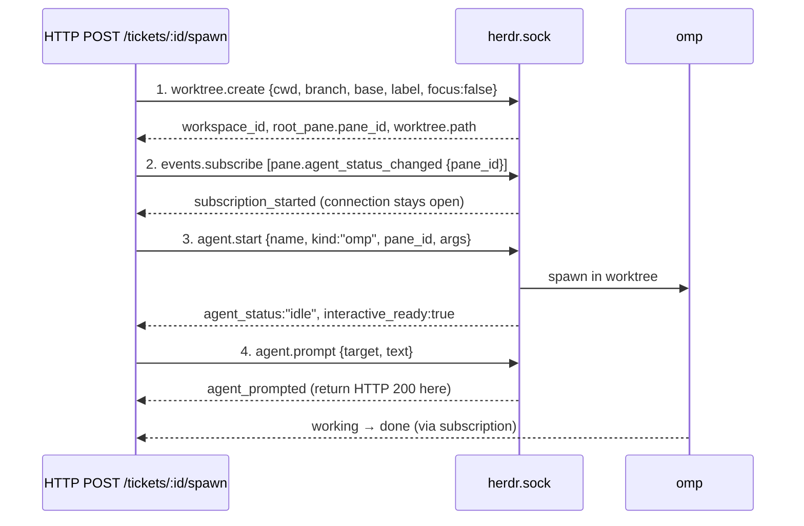

# Spawning an agent

**Node:** spawn · Parent: [INDEX.md](./INDEX.md)

## The spawn sequence — 4 socket calls

### Diagram



### Same thing as a table

| # | Call | Send | Get back |
|---|---|---|---|
| 1 | `worktree.create` | `cwd`, `branch`, `base`, `label`, `focus: false` | `workspace_id`, `root_pane.pane_id`, `worktree.path` |
| 2 | `events.subscribe` | `[{type: "pane.agent_status_changed", pane_id}]` | `subscription_started` — **connection stays open** |
| 3 | `agent.start` | `name`, `kind: "omp"`, `pane_id`, `args` | `agent_status: "idle"`, `interactive_ready: true` |
| 4 | `agent.prompt` | `target`, `text` | `agent_prompted` → **return HTTP 200 here** |

Then, asynchronously on the call-2 connection:

```
pane.agent_status_changed  agent_status: "working"        → agent is running
pane.agent_status_changed  agent_status: "done" | "idle"  → turn finished (both, see [agent-status](./agent-status.md))
```

### Ordering rules (all load-bearing)

- **Step 2 must precede step 3.** Subscribe before starting the agent, or you can miss the
  first `working` transition and the ticket appears stuck in In Progress forever.
- **Step 3 must confirm readiness before step 4.** The raw `agent.start` method returns before the
  agent is usable; the CLI polls for you, a socket client must poll itself. See below.
- **Step 4 must not block the HTTP response.** Return 200 as soon as `agent_prompted` comes
  back. Agent runs are open-ended; the subscription reports completion.

#### `agent.start` does not wait — the CLI does. Replicate the CLI.

**This is the single most important implementation detail in this document.** The socket method
`agent.start` returns as soon as it has *dispatched* the agent, not when the agent is usable. The
`herdr agent start` **CLI command** wraps it in a retry-and-poll loop. Anything talking to the
socket directly must do the same.

Identical conditions — `worktree.create` then `agent.start` with zero delay:

| Path | Elapsed | Result |
|---|---|---|
| `herdr agent start` (CLI) | 3285 ms | `status: idle`, `interactive_ready: true` ✓ |
| Raw `agent.start` (one socket call) | 33 ms | `status: unknown`, `interactive_ready` **absent** ✗ |

The request payloads are **byte-identical** — verified by `strace` on the CLI:

```
{"id":"cli:agent:start","method":"agent.start",
 "params":{"name":"ticket-tr-1","kind":"omp","pane_id":"w2F:p1","timeout_ms":60000}}
```

The difference is entirely in what the CLI does *around* that call:

```
ping → pane.get → agent.start        ← 1st attempt, returns premature
     → pane.get → pane.process_info
     → pane.get → pane.process_info
     → agent.start                   ← 2nd attempt
     → agent.get × 24                ← polls until idle + interactive_ready (~125 ms apart)
```

So the 3.2 s is the **CLI polling**, not the server blocking. The 0.8.2 changelog entry (#2410,
#2537, #2773, #2774) describes the CLI command and is accurate; it does not mean the raw method
blocks until ready.

**Raw-socket behaviour, measured over 6 clean trials** (one immediate `agent.start` per fresh
worktree), all returning in 1–2 ms:

| Outcome | Frequency | Shape |
|---|---|---|
| `type: agent_started`, premature | **4 / 6** | `agent_status: "unknown"`, `interactive_ready` absent; next `agent.prompt` → `agent_not_ready` |
| `agent_pane_busy` error | 2 / 6 | honest failure, nothing launched |

Nondeterministic between the two. Only one response frame arrives and the connection then closes —
confirmed by reading the socket to EOF, so this is the final answer, not an interim ack.

It is *premature*, never false — the agent does arrive:

```
agent.start          →   1.4 ms   status=unknown, interactive_ready absent
agent.get (polled)   →   3046 ms  status=idle,    interactive_ready=true
agent.prompt         →            agent_prompted ✓
```

**`interactive_ready` is the tell:** `true` on a real start, **absent** when premature.

**Required guard — mirror the CLI.** One implementation, `backend/src/agent-boot.ts`
(`bootAgent`), used by **both** `spawn` and Plan; nothing else may talk to `agent.start`:

1. Retry `agent_pane_busy` with a short (~100 ms) backoff, bounded by the `agent.start` timeout.
   Exponential backoff starting at 1 s overshoots; the CLI polls at ~125 ms.
2. **Never treat `agent.start`'s return as readiness.** Poll `agent.get` until `agent_status: "idle"`
   **and** `interactive_ready: true`. Expect ~3 s.
3. Treat `agent_not_ready` from `agent.prompt` as "still starting" and retry — not as fatal.

**Step 3 is not a substitute for step 2** (verified — it cost a production failure). Plan shipped
with the prompt retry and no readiness poll, on the argument that the retry absorbed the same
race. Clicking Plan then returned
`500 agent_not_ready: agent ticket-10x-4-plan is not an active named agent`. The observable
state at that moment, against a plainly healthy Herdr: workspace `wAR` labelled
`ticket-10x-4-plan` existed with an **omp agent running in `wAR:p1`, unnamed**, and
`herdr agent explain ticket-10x-4-plan` answered `agent_not_found`. **That is the symptom to
search for: a live agent in the pane, and `agent.get <name>` saying the name does not exist.**
The retry gives up after 40 × 250 ms = 10 s, the poll waits 60 s — and a prompt is an attempt to
*use* the agent, never a wait for it, so it cannot tell "not registered yet" from "never will
be". Retrying the wrong question is not waiting for the right one.

`pane.process_info` is not a readiness signal on its own: it reports `bash` as foreground from 24 ms
onward, and during the busy window shows the shell still sourcing rc files (`dircolors`,
`['bash','bash']`). The CLI queries it as a heuristic but still relies on `agent.get` to decide.

**General lesson:** the CLI is **not** a thin wrapper over the socket API. Where CLI and raw socket
behaviour disagree, assume the CLI adds orchestration and `strace` it — do not assume Herdr is
broken.

#### Confirmed live in the harness

The guard is not theoretical — it fires on ordinary runs. Two real spawns through
`backend/src/runner.ts`, each a single button press:

| Diagnostic | Ticket 1 | Ticket 2 |
|---|---|---|
| `agent_pane_busy` retries | 1 | 2 |
| `agent.start` returned | `unknown`, ready absent, at 313 ms | same |
| Readiness polls needed | 21 | 21 |
| Actually ready after | 3398 ms | 3383 ms |
| Prompt attempts | 1 | 1 |

Without the guard the prompt would have been sent at ~313 ms against an agent reporting
`unknown`, and lost. With it, both tickets committed correctly.

The `interactive_ready` field is also the fix for the first-`idle` trap
([agent-status](./agent-status.md)) in practice: the harness observed `idle` at t≈1 s (startup),
then `working`, then `done` at t≈5 s. Treating that first `idle` as completion marks a ticket
finished before it has done anything — require an observed `working` first.

### Measured timings (verified)

| Step | Duration |
|---|---|
| `worktree.create` | ~60 ms |
| `agent.start` returns (fresh pane, premature) | 1–2 ms |
| agent actually reaches `idle` + `interactive_ready` | ~3.0 s |
| `agent.prompt` → `done` (trivial one-file ticket) | 15.6 s |
| `worktree.remove` (clean or forced) | ~200–380 ms |

---

## Getting the system prompt and ticket details in

Two different channels. Do not conflate them.

**System prompt → `agent.start` args.** OMP's `--append-system-prompt` accepts a file path.
Keep that file **outside the worktree** (e.g. under a `10x` state dir) so it never pollutes the
ticket's diff or gets committed by the agent.

```
agent.start {
  name: "ticket-<project>-<n>",   // NOT the bare ticket ID — see [naming](./naming.md)
  kind: "omp",
  pane_id: "<from step 1>",
  args: ["--append-system-prompt", "/abs/path/system-prompt.md", "--auto-approve"]
}
```

**Ticket details → `agent.prompt`.** Not as an OMP positional message argument.

Why the split (verified): passing the ticket as an `omp` positional arg makes OMP begin working
during startup, which races Herdr's readiness detection. Keeping startup and the first turn
separate is why `agent.start` reliably returned `interactive_ready: true` in 3.1 s.

**`--append-system-prompt` configures an agent; it does not start a turn.** A started agent with
a system prompt and no `agent.prompt` sits idle and says nothing: it has been told *how* to
behave and never been asked to do anything. **Every started agent needs an opening
`agent.prompt`,** planner as much as implementer. Sending that message is not the same as
waiting for it, and only the waiting is ever optional. *(Verified on the live board: Plan
created the workspace, started the agent with only `--append-system-prompt`, focused the pane —
and the agent never spoke. `spawn` never hit this because it prompts at step 4.)*

Useful OMP flags for unattended runs: `--append-system-prompt`, `--auto-approve`,
`--approval-mode`, `--max-time` (bounds a runaway agent), `--cwd`.

Agent names must match `[a-z][a-z0-9_-]{0,31}` and be unique among live agents. A bare ticket ID
is **not** a valid name when it starts with a digit — always prefix
([naming](./naming.md)).

### Verified end-to-end evidence

A worktree was created on branch `tkt/probe-1`, an OMP agent started in its root pane, and the
prompt *"add an exported `subtract(a, b)` to src/index.ts, then commit"* was sent. Result:
commit `f61fb69` on `tkt/probe-1` containing exactly that function; `main` untouched. Event
stream captured `working` at 01:41:52 → `done` at 01:42:07.

---

## Result shapes are schema-proven — read them, never infer them (verified)

`schemas.success_response` is `{id, result}`, and `result` is `ResponseResult`: a **58-variant
discriminated `oneOf`**, every variant keyed by a `type` const (`workspace_created`,
`worktree_opened`, `pane_list`, `workspace_list`, `agent_started`, `ok`, …) and carrying its
full property list. A result shape is therefore a schema fact. Read it:

```
schemas.success_response.$defs.ResponseResult.oneOf[].properties.type.const   ← variant names
schemas.success_response.$defs.<TypeName>.properties                          ← field types
```

What the schema does **not** state is which method returns which variant. That mapping — and
only that — is what a runtime probe is for.

### The false inference this removes

`WorkspaceInfo` carries **no `pane_id`**. That is true, and it is exactly what misleads:
**`workspace_created` is not a `WorkspaceInfo`.** It wraps `workspace`, `tab` and `root_pane`,
and `root_pane` is a full `PaneInfo`. So "`WorkspaceInfo` has no `pane_id`, therefore
`pane.list` is needed after `workspace.create`" is wrong, and it cost this project a
design round trip. Verified live — one `workspace.create {cwd, label, focus: false}`:

```
workspace.create → {type: "workspace_created",
                    workspace: {workspace_id: "wAP", label: …},
                    tab:       {tab_id: "wAP:t1"},
                    root_pane: {pane_id: "wAP:p1", cwd: …}}
pane.list {workspace_id: "wAP"} → the identical single pane
```

`worktree.create` behaves the same way and `runner.ts` already relies on it
(`created.root_pane.pane_id`). **Take the pane off the create response.**

**`pane.list` is still required after `worktree.open`** — `worktree_opened` carries
`workspace` and `worktree` and genuinely has no pane, which is why runner.ts calls it on that
branch only. That is not dead code; do not delete it by analogy with the create path.

Also verified: `workspace.close {workspace_id}` → `{type: "ok"}`, and the workspace is really
gone from `workspace.list` afterwards. That is the proven close path for both the failed-start
rollback and the plan sweep below.

---

## Planning agents — a second, worktree-less sequence

Plan is the Backlog conversation: an agent that talks to the human about what a ticket should
say, writes the ticket by PATCHing the API, and implements nothing. `backend/src/planner.ts`
owns it, apart from `runner.ts`, because the *worktree-shaped* parts of `spawn` are wrong here.
**Booting the agent is not one of those parts.** Steps 3-4 below are one call into
`backend/src/agent-boot.ts`, the same call `spawn` makes; only the `agent.start` args and the
opening text differ.

| # | Call | Send | Get back |
|---|---|---|---|
| 1 | `agent.get` | `target: <plan name>` | the planner, or `agent_not_found` |
| 2 | `workspace.create` | `cwd: <project repoPath>`, `label: <plan name>`, `focus: false` | `workspace.workspace_id`, `root_pane.pane_id` |
| 3 | `agent.start` | `name`, `kind: "omp"`, `pane_id`, `args` | `agent_started`, **premature** |
| 3b | `agent.get` × n | `target: <plan name>` | polled until `idle` + `interactive_ready` |
| 4 | `agent.prompt` | `target`, `text: <the ticket as it stands>` | `agent_prompted` |
| 5 | `agent.focus` | `target: <plan name>` | `ok` → **return HTTP 200 here** |

What it does **not** do, each for a reason:

- **No worktree, no branch, no port slot.** The planner reads the codebase the human is
  working in and commits nothing, so a worktree would be an empty branch nobody ever uses, and
  a port block would spend a tenth of a ten-wide pool on a conversation. `reservePortSlot` is
  called by `/spawn` and nowhere else.
- **No `--wait` and no completion subscription.** The opening prompt is sent and the route
  returns; the planner's first act is to ask the human a question, so anything that waited for
  it to settle would block until the conversation ended. Prompting is required, *waiting on the
  conversation* is the thing that is forbidden — do not collapse the two, which is how the
  planner shipped mute. Waiting for the agent to be able to *hear* the question (step 3b) is a
  different thing and is mandatory.
- **No status write.** Promoting the ticket out of backlog is the human deciding the plan is
  ready; `prompts/plan.md` tells the agent so explicitly.

What it shares with `spawn`, and must:

- **The whole boot: start, readiness poll, prompt** — `bootAgent`, one implementation, no way
  to opt out of the poll. Plan once had its own copy of the start-and-prompt half with the poll
  left out, and that is exactly the bug above. `workspace.create` also hands over a pane whose
  shell may not have reached its interactive prompt, the same 2-in-6 `agent_pane_busy` failure
  measured above, so the retry is not padding either.
- **Step 2 before step 3, and the rollback between them.** If the boot fails after the
  workspace exists, `workspace.close` it before returning the error — the sweep that would
  otherwise collect it only runs at boot.
- **Idempotence at step 1.** A live planner is re-focused, never replaced: Herdr keeps panes
  and agents alive across a backend restart, so a second Plan click must resume the
  conversation rather than destroy its context. Only `agent_not_found` counts as absent
  ([agent names are session-wide](./naming.md)); any other code is a fault, because reading a
  Herdr hiccup as absence starts a rival planner beside a live conversation. This check is the
  planner's own, *before* it creates anything — `spawn`'s reuse is a different shape (it learns
  the agent exists from `agent_name_taken` on the start and re-attaches with `reattachAgent`),
  so reuse is decided by each caller and never inside the shared boot.
- **Prompt before focus, and no prompt on re-focus.** Focusing first drops the human into a
  pane that looks dead until the prompt lands. A second Plan click focuses only: re-prompting
  would restart a live conversation, and a planner waiting on a human question is `blocked`,
  which `agent.prompt` refuses with `agent_blocked` ([agent-status](./agent-status.md)).

---

## Provisioning a skill into a spawned agent's worktree

**The general mechanism, not a one-off.** `backend/src/skills.ts` exports `provisionSkill
(worktreePath, name)`, called from `runner.ts`'s `spawn()` (step 2, alongside `injectPortBlock`
— both must land before step 4, since OMP discovers `.agents/skills/*` at `agent.start`, not
later). It copies `skills/<name>/` — a sibling of `prompts/`, prose a human edits, resolved the
same way (`import.meta.dirname`, see prompts.ts) — verbatim into `.agents/skills/<name>/`
inside the worktree, which is the exact path OMP reads a skill from: this repo's own
`.agents/skills/playwright-cli/` is what puts `playwright-cli` in an agent's `<skills>` list
when it is pointed at 10x itself, and a provisioned skill is discovered the identical way.

**Deliberately generic.** One function, keyed by name, that copies and templates nothing — so
*which* skills a ticket gets (today: always `visual-diff`; later: a set chosen by
`ticket.playbook`) is the call site's decision, never this function's. Anything ticket-specific
a skill needs (an API URL, a ticket id) goes in the **system prompt** instead
(`prompts/implementation.md`'s `{{apiUrl}}`/`{{ticketId}}` markers), never baked into the
skill file itself — that is what keeps the skill a plain verbatim copy with nothing to render.

**Never overwrites a skill the target repo already tracks under that name.** `git.ts`'s
`isTracked` checks `git ls-files` on the base branch before copying — present there means the
project committed its own `.agents/skills/<name>/`, and `provisionSkill` returns without
touching it (no copy, no exclude entry either, since it was never 10x's file to hide). A name
collision is a real, if unlikely, possibility: nothing stops a project from carrying a skill of
its own under the same name 10x happens to provision.

**Excluded from git exactly like the port `.env`.** `git.ts` (`excludeFromGit`, extracted from
what `injectPortBlock` used to inline) appends `.agents/skills/<name>/` to the worktree's
shared `info/exclude`, the same file and the same reasoning as the port block: this is 10x's
own tooling landing in the worktree, not the project's code, and it must never surface in the
agent's diff or the pull request it opens. Naming the exact skill, not `.agents/skills/`
wholesale, means provisioning one skill cannot blind a project that tracks its own — this repo
tracks `playwright-cli` there, on the base branch, and a ticket built in another project's
worktree must not have that committed entry treated as ours to hide.

**The one skill built so far: `visual-diff`.** Captures the before/after screenshot pair for
`screenshot_before`/`screenshot_after` (`backend/src/db.ts`), via `playwright-cli` over `npx`
rather than `.agents/skills/playwright-cli` — a target project has no reason to carry that
skill itself, so the visual-diff skill's own prose names the pinned `npx` invocation directly.
Uploads through the one binary-body route in the API, `POST
/tickets/:id/screenshots/:side` (`server.ts`, deliberately not folded into the JSON-bodied
`handle()`), served back at `GET /screenshots/<file>` from `SCREENSHOTS_DIR`
(`screenshots.ts`, a sibling of `sessions/` under `STATE_DIR` — never inside the worktree, so
nothing captured can end up in the agent's own diff). Deleting a ticket deletes both files
(`deleteScreenshots`, called from `DELETE /tickets/:id`): the same automatic-reclaim treatment
a port slot already gets ([architecture](./architecture.md)), because they are 10x's own
bookkeeping, never the user's work — unlike the worktree and branch that same route also tears
down, which [teardown](./teardown.md) never removes without an explicit user action.

**The upload is hardened against more than a happy-path PNG.** A running byte count aborts
`readRawBody` past `MAX_SCREENSHOT_BYTES` (10 MiB) without destroying the connection — killing
the socket the instant the cap trips races the client reading the 413 it was about to send, and
that reads as a bare connection reset rather than an HTTP error; the excess is dropped, not
buffered, and the stream is left to drain to its own `end`. A declared `Content-Type` other
than `image/png` is `400 invalid_content_type` before the bytes are even looked at, and the
bytes themselves are checked against the real PNG magic number (`400 invalid_image`) so a
client that lies about its header cannot land a non-image file behind a `.png` path.

**Verified live, not just in tests.** Ticket 10x-5's own Before/After panes on the real board
carry a real light-theme and dark-theme capture of the kanban board itself, uploaded through
this exact route against the production server — the "one real UI ticket, verified by hand"
case this mechanism exists for.
