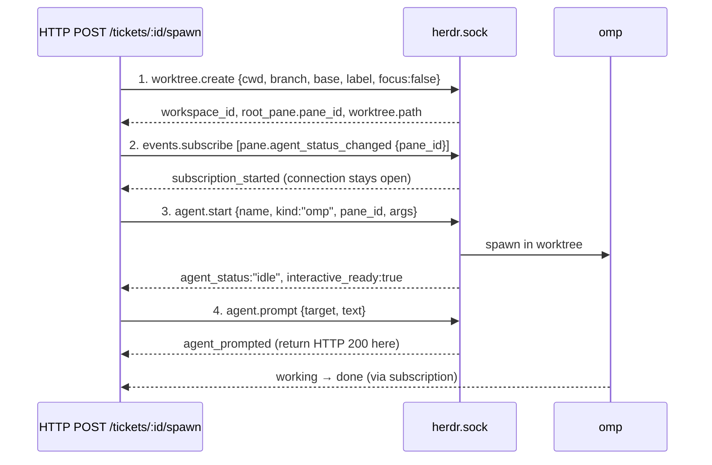

# Spawning an agent

**Node:** spawn · Parent: [INDEX.md](./INDEX.md)

## The spawn sequence — 4 socket calls

### Diagram



### Same thing as a table

| # | Call | Send | Get back |
|---|---|---|---|
| 1 | `worktree.create` | `cwd`, `branch`, `base`, `label`, `focus: false` | `workspace_id`, `root_pane.pane_id`, `worktree.path` |
| 2 | `events.subscribe` | `[{type: "pane.agent_status_changed", pane_id}]` | `subscription_started` — **connection stays open** |
| 3 | `agent.start` | `name`, `kind: "omp"`, `pane_id`, `args` | `agent_status: "idle"`, `interactive_ready: true` |
| 4 | `agent.prompt` | `target`, `text` | `agent_prompted` → **return HTTP 200 here** |

Then, asynchronously on the call-2 connection:

```
pane.agent_status_changed  agent_status: "working"        → agent is running
pane.agent_status_changed  agent_status: "done" | "idle"  → turn finished (both, see [agent-status](./agent-status.md))
```

### Ordering rules (all load-bearing)

- **Step 2 must precede step 3.** Subscribe before starting the agent, or you can miss the
  first `working` transition and the ticket appears stuck in In Progress forever.
- **Step 3 must confirm readiness before step 4.** The raw `agent.start` method returns before the
  agent is usable; the CLI polls for you, a socket client must poll itself. See below.
- **Step 4 must not block the HTTP response.** Return 200 as soon as `agent_prompted` comes
  back. Agent runs are open-ended; the subscription reports completion.

#### `agent.start` does not wait — the CLI does. Replicate the CLI.

**This is the single most important implementation detail in this document.** The socket method
`agent.start` returns as soon as it has *dispatched* the agent, not when the agent is usable. The
`herdr agent start` **CLI command** wraps it in a retry-and-poll loop. Anything talking to the
socket directly must do the same.

Identical conditions — `worktree.create` then `agent.start` with zero delay:

| Path | Elapsed | Result |
|---|---|---|
| `herdr agent start` (CLI) | 3285 ms | `status: idle`, `interactive_ready: true` ✓ |
| Raw `agent.start` (one socket call) | 33 ms | `status: unknown`, `interactive_ready` **absent** ✗ |

The request payloads are **byte-identical** — verified by `strace` on the CLI:

```
{"id":"cli:agent:start","method":"agent.start",
 "params":{"name":"ticket-tr-1","kind":"omp","pane_id":"w2F:p1","timeout_ms":60000}}
```

The difference is entirely in what the CLI does *around* that call:

```
ping → pane.get → agent.start        ← 1st attempt, returns premature
     → pane.get → pane.process_info
     → pane.get → pane.process_info
     → agent.start                   ← 2nd attempt
     → agent.get × 24                ← polls until idle + interactive_ready (~125 ms apart)
```

So the 3.2 s is the **CLI polling**, not the server blocking. The 0.8.2 changelog entry (#2410,
#2537, #2773, #2774) describes the CLI command and is accurate; it does not mean the raw method
blocks until ready.

**Raw-socket behaviour, measured over 6 clean trials** (one immediate `agent.start` per fresh
worktree), all returning in 1–2 ms:

| Outcome | Frequency | Shape |
|---|---|---|
| `type: agent_started`, premature | **4 / 6** | `agent_status: "unknown"`, `interactive_ready` absent; next `agent.prompt` → `agent_not_ready` |
| `agent_pane_busy` error | 2 / 6 | honest failure, nothing launched |

Nondeterministic between the two. Only one response frame arrives and the connection then closes —
confirmed by reading the socket to EOF, so this is the final answer, not an interim ack.

It is *premature*, never false — the agent does arrive:

```
agent.start          →   1.4 ms   status=unknown, interactive_ready absent
agent.get (polled)   →   3046 ms  status=idle,    interactive_ready=true
agent.prompt         →            agent_prompted ✓
```

**`interactive_ready` is the tell:** `true` on a real start, **absent** when premature.

**Required guard — mirror the CLI:**

1. Retry `agent_pane_busy` with a short (~100 ms) backoff, bounded by the `agent.start` timeout.
   Exponential backoff starting at 1 s overshoots; the CLI polls at ~125 ms.
2. **Never treat `agent.start`'s return as readiness.** Poll `agent.get` until `agent_status: "idle"`
   **and** `interactive_ready: true`. Expect ~3 s.
3. Treat `agent_not_ready` from `agent.prompt` as "still starting" and retry — not as fatal.

`pane.process_info` is not a readiness signal on its own: it reports `bash` as foreground from 24 ms
onward, and during the busy window shows the shell still sourcing rc files (`dircolors`,
`['bash','bash']`). The CLI queries it as a heuristic but still relies on `agent.get` to decide.

**General lesson:** the CLI is **not** a thin wrapper over the socket API. Where CLI and raw socket
behaviour disagree, assume the CLI adds orchestration and `strace` it — do not assume Herdr is
broken.

#### Confirmed live in the harness

The guard is not theoretical — it fires on ordinary runs. Two real spawns through
`src/runner.ts`, each a single button press:

| Diagnostic | Ticket 1 | Ticket 2 |
|---|---|---|
| `agent_pane_busy` retries | 1 | 2 |
| `agent.start` returned | `unknown`, ready absent, at 313 ms | same |
| Readiness polls needed | 21 | 21 |
| Actually ready after | 3398 ms | 3383 ms |
| Prompt attempts | 1 | 1 |

Without the guard the prompt would have been sent at ~313 ms against an agent reporting
`unknown`, and lost. With it, both tickets committed correctly.

The `interactive_ready` field is also the fix for the first-`idle` trap
([agent-status](./agent-status.md)) in practice: the harness observed `idle` at t≈1 s (startup),
then `working`, then `done` at t≈5 s. Treating that first `idle` as completion marks a ticket
finished before it has done anything — require an observed `working` first.

### Measured timings (verified)

| Step | Duration |
|---|---|
| `worktree.create` | ~60 ms |
| `agent.start` returns (fresh pane, premature) | 1–2 ms |
| agent actually reaches `idle` + `interactive_ready` | ~3.0 s |
| `agent.prompt` → `done` (trivial one-file ticket) | 15.6 s |
| `worktree.remove` (clean or forced) | ~200–380 ms |

---

## Getting the system prompt and ticket details in

Two different channels. Do not conflate them.

**System prompt → `agent.start` args.** OMP's `--append-system-prompt` accepts a file path.
Keep that file **outside the worktree** (e.g. under a `10x` state dir) so it never pollutes the
ticket's diff or gets committed by the agent.

```
agent.start {
  name: "ticket-<project>-<n>",   // NOT the bare ticket ID — see [naming](./naming.md)
  kind: "omp",
  pane_id: "<from step 1>",
  args: ["--append-system-prompt", "/abs/path/system-prompt.md", "--auto-approve"]
}
```

**Ticket details → `agent.prompt`.** Not as an OMP positional message argument.

Why the split (verified): passing the ticket as an `omp` positional arg makes OMP begin working
during startup, which races Herdr's readiness detection. Keeping startup and the first turn
separate is why `agent.start` reliably returned `interactive_ready: true` in 3.1 s.

Useful OMP flags for unattended runs: `--append-system-prompt`, `--auto-approve`,
`--approval-mode`, `--max-time` (bounds a runaway agent), `--cwd`.

Agent names must match `[a-z][a-z0-9_-]{0,31}` and be unique among live agents. A bare ticket ID
is **not** a valid name when it starts with a digit — always prefix
([naming](./naming.md)).

### Verified end-to-end evidence

A worktree was created on branch `tkt/probe-1`, an OMP agent started in its root pane, and the
prompt *"add an exported `subtract(a, b)` to src/index.ts, then commit"* was sent. Result:
commit `f61fb69` on `tkt/probe-1` containing exactly that function; `main` untouched. Event
stream captured `working` at 01:41:52 → `done` at 01:42:07.
